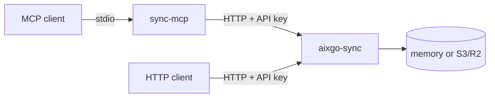

# Aixgo

AI agents in Go.

**Start at [aixgo.dev](https://aixgo.dev).** The site is the docs and product pages. This org is the source.

## Repositories

| Project | What it is |
| --- | --- |
| [aixgo](https://github.com/aixgo-dev/aixgo) | YAML multi-agent orchestration, 8+ LLM providers, one binary |
| [aixgate](https://github.com/aixgo-dev/aixgate) | Deny-by-default sandbox for AI coding agents |
| [sync](https://github.com/aixgo-dev/sync) | Coordination plane: sessions, messages, and jobs as CAS JSON on memory or S3/R2. HTTP with tenant API keys. v0.1.0 |
| [sync-mcp](https://github.com/aixgo-dev/sync-mcp) | MCP stdio server for Sync |

[Code](https://github.com/aixgo-dev/code) is an autonomous coding agent that runs in your GitHub.

## Sync

Sync holds shared JSON for an org and project. HTTP clients call it with a tenant API key. MCP clients go through `sync-mcp` on stdio.

v0.1.0 is sessions, messages, and jobs. Session attach, notify, and Code offload come later.
